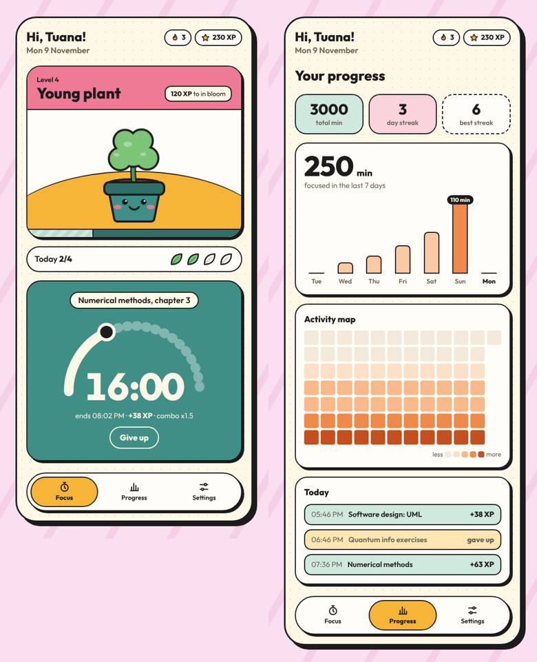

# FocusFlow

FocusFlow is a focus timer that works like a small game. Each session you finish gives you XP and grows a plant in a pot with a face; if you give up halfway, the plant gets sad.

**Live demo:** https://focusflow-TODO.vercel.app <!-- TODO: Vercel linkini buraya yaz -->



## The problem

A plain timer makes it easy to put off a study session or stop it early. FocusFlow gives finishing a reward you can see and makes quitting cost a little.

<!-- TODO: İstersen buraya bu uygulamayı neden yaptığını kendi cümlelerinle 1-2 cümle yaz -->

## How it works

**Focus**
- Write what you're working on and pick 15, 25 or 50 minutes, or type your own (1–120).
- Finish the session to earn **1 XP per minute**.
- Finishing sessions back to back builds a **combo**: each one adds 0.25x, up to 2x.
- The plant grows through six stages: seed, sprout, sapling, young plant, in bloom, tree.
- **Giving up** gives no XP, resets the combo and makes the plant sad until you finish the next session.
- A row of leaves shows how many sessions you finished today against your daily goal.

**Progress**
- Total focused minutes, current streak and best streak
- Minutes per day for the last 7 days
- An activity map of the last 12 weeks
- Today's sessions, including the ones you gave up

**Settings**
- Your name for the greeting, daily goal (1–8 sessions), sound on/off, reset progress

Progress is saved in your browser (`localStorage`). There is no account and no server.

The timer stores the end time instead of counting seconds, so it stays correct when the tab is in the background or the page is reloaded. Wrong input (empty, letters, decimals, 0, over 120) shows a message instead of starting, and broken saved data is ignored instead of crashing the app.

## Tech

- React 19 + TypeScript, built with Vite
- Plain CSS; the plant and icons are hand-written SVG
- Vitest for the game rules
- Deployed on Vercel

## Project structure

```
src/
  lib/game.ts             game rules: XP, combo, streak, stages, input checks
  lib/game.test.ts        tests for the rules
  lib/storage.ts          save/load with checks for broken data
  hooks/useNow.ts         clock that ticks while a session runs
  components/
    FocusTab.tsx          plant card, daily goal, timer
    PlantMascot.tsx       the plant drawing for each stage
    SessionSetup.tsx      form to start a session
    Timer.tsx             running session with progress arc
    ProgressTab.tsx       stats, weekly chart, activity map
    SettingsTab.tsx       name, goal, sound, reset
    BottomNav.tsx         tab bar
  App.tsx                 state and saving, connects the tabs
```

## Run it locally

```bash
npm install
npm run dev     # http://localhost:5173
npm test        # run the tests
npm run build   # production build in dist/
```

## Ideas for later

- Notification when a session ends while the tab is closed
- Short and long breaks between sessions
- More plant types to unlock

Made by [Tuana Metdar](https://tuana0410.github.io).
